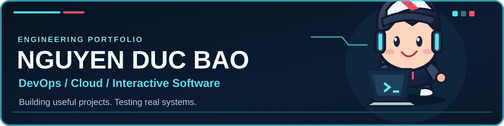
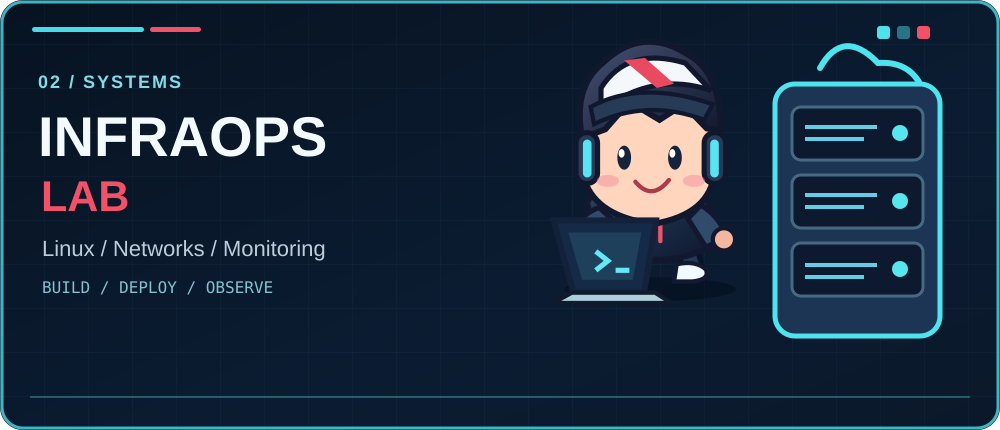
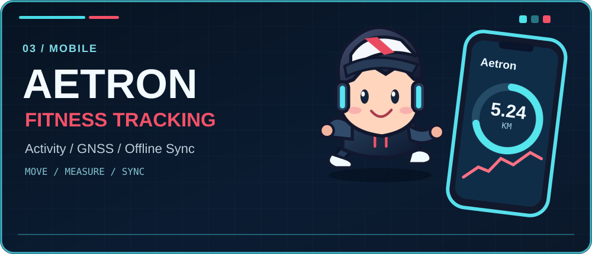

<strong>DevOps / Cloud</strong> · Systems · Interactive Software

### Featured Projects

<strong>PODIUM F1</strong> · Interactive Formula 1 experience

<a href="https://podiumeds.vercel.app">Live website</a> · <a href="https://github.com/DB-Ducbao113/Podium-Effet-De-Sol">Repository</a>

<table>
<tr>
<td width="50%" valign="top" align="center">

<strong>INFRASTRUCTURE &amp; SYSTEMS</strong>

Networking · Linux · Monitoring

<a href="https://github.com/DB-Ducbao113/EnterpriseNetwork">Network</a> · <a href="https://github.com/DB-Ducbao113/DeployLinuxSystem">Linux</a>
</td>
<td width="50%" valign="top" align="center">

<strong>AETRON</strong>

Flutter · GPS · Cloud Sync

<a href="https://github.com/DB-Ducbao113/FitnessExerciseApplication">Repository</a>
</td>
</tr>
</table>

### Toolkit

BUILD · TEST · DEPLOY · OBSERVE

