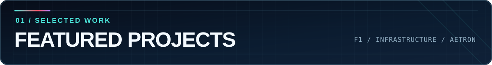
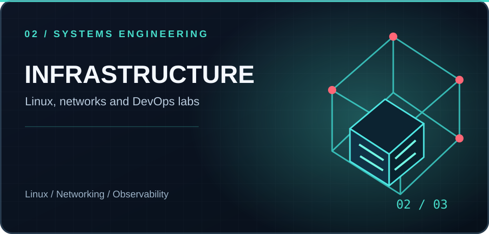
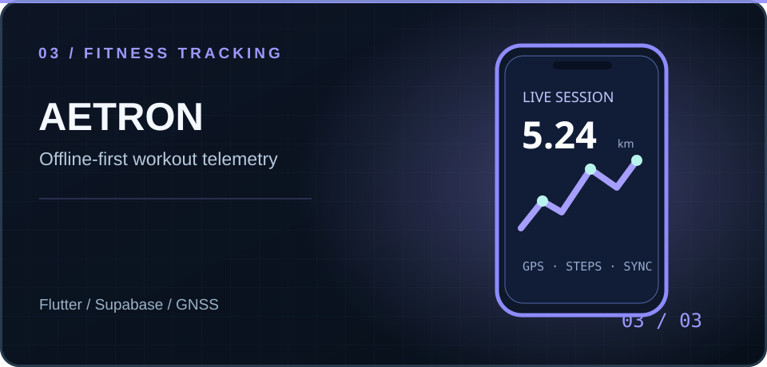

  
  
<strong>DEVOPS / CLOUD</strong> &nbsp; · &nbsp; <strong>SYSTEMS &amp; NETWORKING</strong> &nbsp; · &nbsp; <strong>INTERACTIVE SOFTWARE</strong>

  

    
    
  

  
<i>Building reliable systems, measurable performance, and software with a distinct visual experience.</i>

---

<table>
<tr>
<td width="50%" valign="top">

<strong>01 — PODIUM EFFET DE SOL · FORMULA 1</strong>

Interactive F1 experience: racing seasons, drivers, teams, and a 3D car showroom. React, TypeScript, and Three.js.

<a href="https://podiumeds.vercel.app">Live experience</a> · <a href="https://github.com/DB-Ducbao113/Podium-Effet-De-Sol">Repository</a> · <a href="https://github.com/DB-Ducbao113/F1-Overview">Original frontend</a>

</td>
<td width="50%" valign="top">

<strong>02 — INFRASTRUCTURE &amp; SYSTEMS</strong>

Enterprise networking, Linux deployment, TCP analysis, and evidence-based operational verification.

<a href="https://github.com/DB-Ducbao113/EnterpriseNetwork">Enterprise Network</a> · <a href="https://github.com/DB-Ducbao113/DeployLinuxSystem">Linux Deployment</a>

</td>
</tr>
<tr>
<td width="50%" valign="top">

<strong>03 — AETRON · FITNESS TRACKING</strong>

Flutter workout sessions, GNSS processing, offline-first data, cloud sync, and GPS filtering evaluation.

<a href="https://github.com/DB-Ducbao113/FitnessExerciseApplication">Repository</a>

</td>
<td width="50%" valign="top">
<h3>NOW BUILDING</h3>

<strong>DevOps / Cloud Engineering</strong>

Hands-on systems work with an emphasis on automated deployment, monitoring, repeatable testing, and troubleshooting.

<code>LINUX → CONTAINERS → CI/CD → OBSERVABILITY → CLOUD</code>

<strong>Operating principle:</strong> verify behavior, measure results, keep changes small and reproducible.

</td>
</tr>
</table>

---

NGUYEN DUC BAO &nbsp; / &nbsp; BUILD • DEPLOY • OBSERVE • IMPROVE

