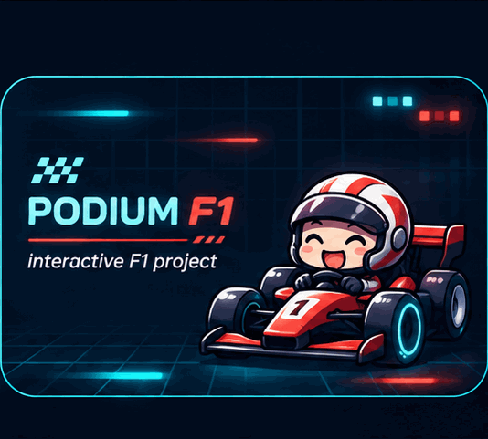
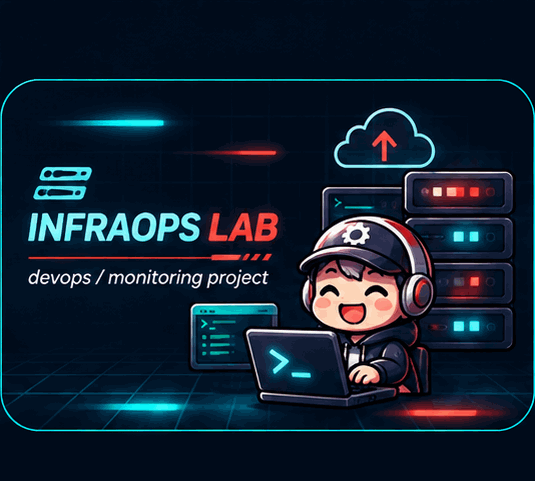
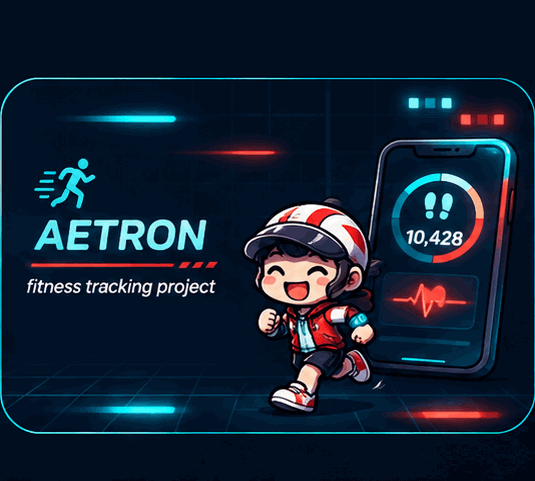

**DevOps / Cloud** · Systems · Interactive Software

### Featured Projects

<table>
<tr>
<td width="50%" valign="top" align="center">

<strong>PODIUM F1</strong>

Interactive F1 · React · Three.js

<a href="https://podiumeds.vercel.app">Live site</a> · <a href="https://github.com/DB-Ducbao113/Podium-Effet-De-Sol">Repository</a>
</td>
<td width="50%" valign="top" align="center">

<strong>F1 2026 · ORIGINAL ANIMATION</strong>

Your original animated F1 cars — kept intact.

<a href="https://podiumeds.vercel.app">Explore the F1 project</a>
</td>
</tr>
<tr>
<td width="50%" valign="top" align="center">

<strong>INFRASTRUCTURE &amp; SYSTEMS</strong>

Networking · Linux · Monitoring

<a href="https://github.com/DB-Ducbao113/EnterpriseNetwork">Network lab</a> · <a href="https://github.com/DB-Ducbao113/DeployLinuxSystem">Linux lab</a>
</td>
<td width="50%" valign="top" align="center">

<strong>AETRON</strong>

Flutter · GPS · Cloud Sync

<a href="https://github.com/DB-Ducbao113/FitnessExerciseApplication">Repository</a>
</td>
</tr>
</table>

### Toolkit

BUILD · TEST · DEPLOY · OBSERVE

