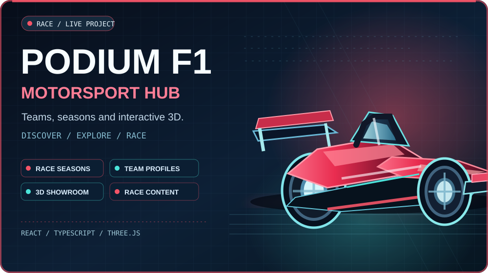
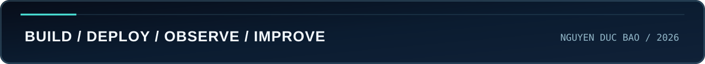

<strong>DEVOPS / CLOUD</strong> &nbsp; · &nbsp; <strong>SYSTEMS &amp; NETWORKING</strong> &nbsp; · &nbsp; <strong>INTERACTIVE SOFTWARE</strong>

  
  

<em>Building reliable systems, measurable performance, and interactive software with purpose.</em>

 

<!-- Featured project: full-width cover; the animated chibi preview remains available below. -->

  
  
<strong>01 — PODIUM EFFET DE SOL / FORMULA 1</strong>

  
Interactive F1 experiences exploring racing seasons, drivers, teams, and a 3D car showroom. Built with React, TypeScript, and Three.js.

  
<a href="https://podiumeds.vercel.app">Live experience</a> &nbsp;·&nbsp; <a href="https://github.com/DB-Ducbao113/Podium-Effet-De-Sol">Public repository</a>

<strong>2026 F1 animated preview (chibi edition)</strong>

 

<table>
<tr>
<td width="50%" valign="top">

<strong>02 — INFRASTRUCTURE &amp; SYSTEMS</strong>

Enterprise networking, Linux deployment, TCP performance analysis, and practical operational verification.

<a href="https://github.com/DB-Ducbao113/EnterpriseNetwork">Enterprise Network</a> · <a href="https://github.com/DB-Ducbao113/DeployLinuxSystem">Linux Deployment</a> · <a href="https://github.com/DB-Ducbao113/TCP-Performance-Analysis">TCP Analysis</a>

</td>
<td width="50%" valign="top">

<strong>03 — AETRON / FITNESS TRACKING</strong>

Flutter workout sessions, GNSS processing, offline-first data, cloud sync, and activity tracking evaluation.

<a href="https://github.com/DB-Ducbao113/FitnessExerciseApplication">Public repository</a>

</td>
</tr>
</table>

 

Focused on practical infrastructure: Linux, containers, CI/CD, monitoring, repeatable testing, and troubleshooting.

 

 

